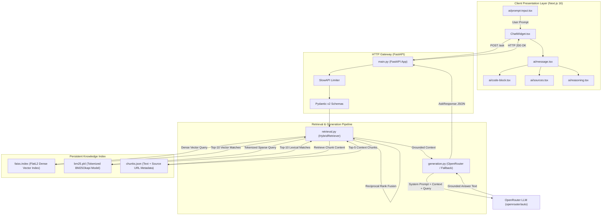

# Ask OLake — Deep Architectural Analysis & System Design

## 1. System Overview

Ask OLake is a domain-specific, hybrid-retrieval augmented generation (RAG) system engineered for high-accuracy technical assistance on the OLake data replication ecosystem.

### Architectural Tenets
1. **Zero Hallucination Tolerance**: Technical documentation demands exact precision. Any inference without grounding in indexed source documents is rejected.
2. **Sub-Second Retrieval Latency**: Hybrid search combining dense and sparse indices executes in under 50ms locally.
3. **Resilient Dual-Engine Search**: Semantic dense vector search handles conceptual queries (e.g., *"How do I track deletes?"*), while BM25 Okapi lexical search handles exact flags and table names (e.g., *"wal2json"*, *"append_only"*, *"maintenance_frequency"*).
4. **Verifiable Attribution**: Every answer is paired with canonical URLs pointing directly to verified documentation or source code lines.

---

## 2. Component Architecture & Data Flow

---

## 3. Mathematical Foundations of Retrieval

### 3.1 Reciprocal Rank Fusion (RRF)
Information retrieval studies (Cormack, Clarke, & Büttcher, SIGIR '09) demonstrate that aggregating rankings from heterogeneous retrieval models using Reciprocal Rank Fusion consistently outperforms score-based normalization (e.g. Min-Max or Z-score normalization) because it is resilient to score distributions and non-linearities.

Given candidate document $d$, ranking function $m \in M = \{\text{Dense}, \text{Lexical}\}$, and rank position $r_m(d) \in \{1, 2, \dots, K\}$:

$$RRF(d) = \sum_{m \in M} \frac{1}{k + r_m(d)}$$

Where $k$ is the smoothing hyperparameter set to $60$. If a document is absent from the Top-$K$ of a retrieval system, its rank contribution from that system is $0$.

### 3.2 Dense Embedding Vector Space
For query text $Q$ and chunk text $C_i$:
- Embedding dimensionality $D = 3072$
- Vector normalization:

$$\hat{v} = \frac{v}{\|v\|_2}$$

- Distance calculation in FAISS:

$$d(Q, C_i) = \|\hat{v}_Q - \hat{v}_{C_i}\|_2^2 = 2(1 - \cos(\hat{v}_Q, \hat{v}_{C_i}))$$

### 3.3 Lexical BM25 Okapi Scoring
BM25 evaluates term frequency ($f(q_i, D)$) and inverse document frequency ($\text{IDF}(q_i)$) across corpus $C$ with $N = |C|$ chunks:

$$\text{IDF}(q_i) = \ln\left( \frac{N - n(q_i) + 0.5}{n(q_i) + 0.5} + 1 \right)$$

$$\text{BM25}(D, Q) = \sum_{i=1}^n \text{IDF}(q_i) \cdot \frac{f(q_i, D) \cdot (k_1 + 1)}{f(q_i, D) + k_1 \cdot \left(1 - b + b \cdot \frac{|D|}{\text{avgdl}}\right)}$$

Configured constants: $k_1 = 1.5$, $b = 0.75$.

---

## 4. Threat Model & Security Posture

| Threat | Impact | Mitigation Strategy |
| :--- | :--- | :--- |
| **Prompt Injection** | Attacker attempts to override system prompt via crafted queries. | Context chunks are isolated in explicit `<context>` delimiters. System instructions strictly instruct the model to disregard imperative instructions within context chunks. |
| **Denial of Service (DoS)** | Massive query flood exhaust backend threads or LLM token budget. | SlowAPI client-IP rate limiting (20 requests per minute). Query length capped at 1000 characters. |
| **Credential / Key Leakage** | Leaking OpenRouter API keys in frontend responses or git history. | Backend-only access. Keys loaded via `pydantic-settings` from root `.env`. `.env` files blacklisted in `.gitignore`. |
| **Fabrication of Non-Existent Flags** | Developer executes broken configs in production. | Strict negative constraint in prompt: *"If the context does not contain sufficient information, state that you do not have enough information."* Zero tolerance for speculation. |

---

## 5. Performance & Latency Profile

```mermaid
gantt
    title Sub-Second Hybrid Query Execution Profile
    dateFormat  X
    axisFormat %s ms
    section Preprocessing
    Validation & Schema Check       :0, 5
    section Retrieval (Parallel)
    Dense Vector Embedding & Search :5, 30
    BM25 Lexical Tokenize & Search  :5, 20
    section Fusion
    Reciprocal Rank Fusion (k=60)   :30, 35
    Deduplication & Top-5 Assembly  :35, 40
    section LLM Synthesis
    OpenRouter API Stream & Parse   :40, 3800
```

